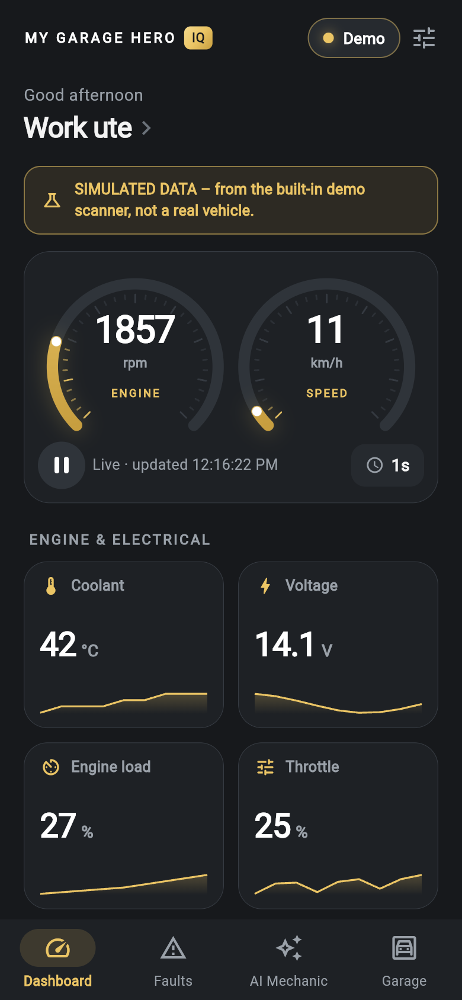
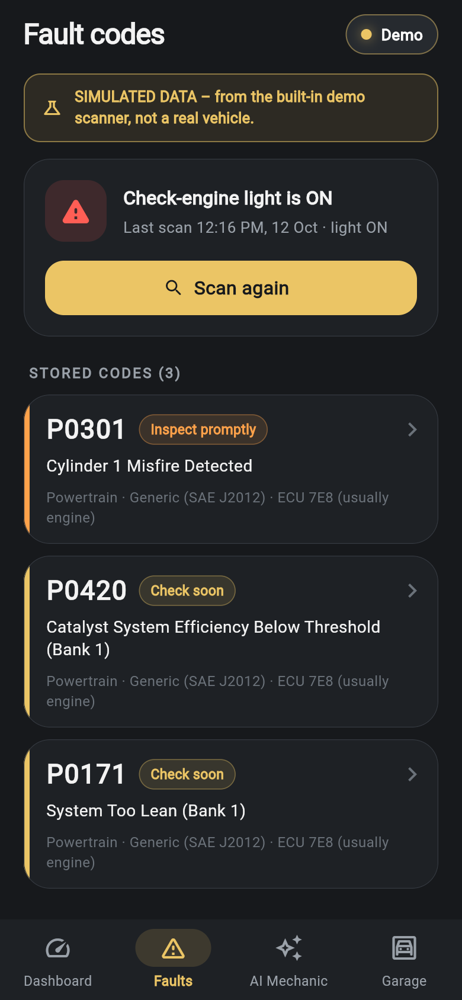
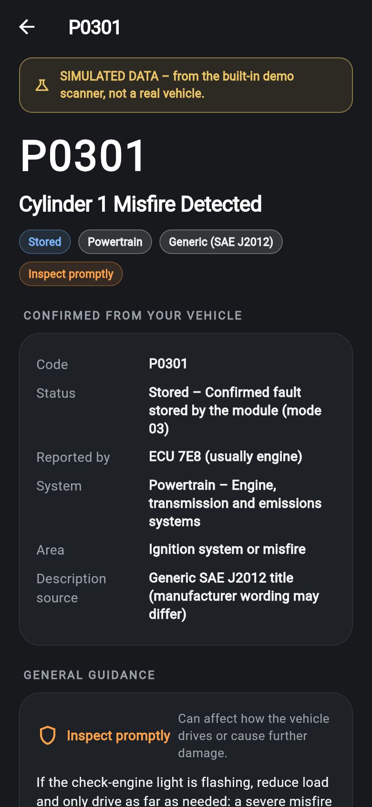
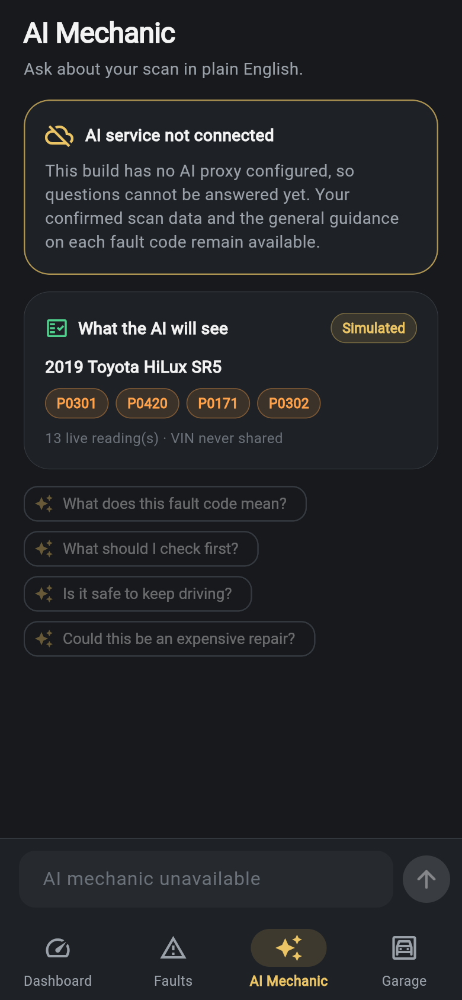

# My Garage Hero IQ

Branded iPhone app (Flutter) for the **Boost N' Inflate IQ**. It reads live
engine data and check-engine codes through the IQ's OBD-II scanner, explains
them with an AI mechanic, and keeps a garage of vehicles and shareable
diagnostic reports.

> **Honest status:** the app is fully functional with its built-in
> **simulated scanner**, and the Bluetooth/ELM327 stack is implemented and
> tested against synthetic data. The supplier's protocol document confirms
> the IQ's OBD module uses the ELM327 AT command set the app implements, but
> the app has **not yet been connected to a real IQ** and the Bluetooth
> details are still unconfirmed. See
> [docs/HARDWARE_INVESTIGATION.md](docs/HARDWARE_INVESTIGATION.md).

| Dashboard | Fault codes | Fault detail | AI mechanic |
|---|---|---|---|
|  |  |  |  |

(Screenshots are from the web preview build with simulated data, so they are
clearly labelled as simulated.)

## What's in the box

* **Onboarding** with Bluetooth permission guidance and *Connect My IQ*.
* **Device connection:** passive BLE scan, classified device list, saved
  scanner reconnect, step-by-step progress, timeouts, troubleshooting,
  "ignition off" handling, demo scanner and an advanced Wi-Fi option.
* **Dashboard:** RPM and speed gauges, coolant, module voltage, engine load,
  throttle, trouble-code count and check-engine light, battery voltage at the
  port, sparklines, and polling controls (pause and 0.5–5 s rate).
  Unsupported values show as *Not supported by vehicle*, never estimated.
* **Fault codes:** stored and pending codes with description, category,
  generic/manufacturer type, source module, guidance level and a "further
  diagnosis required" notice. **No code clearing** (blocked at the protocol
  layer).
* **AI Mechanic:** separates *confirmed data* (from the car) from *possible
  causes*, *next checks*, *safety*, *cost outlook* and *unknowns*. Runs
  through a backend proxy, so no API key is in the app and VINs are never sent.
* **Garage and reports:** vehicle profiles (VIN optional, masked), history,
  and a readable report shared through the iOS share sheet.
* **Developer diagnostics:** connection state, transport, device id, UUIDs,
  commands and responses, decoded values, redacted log export, read-only GATT
  inspector, shareable hardware report, and the **Milestone 1 runner**.

## Project layout

```
lib/
  main.dart, app/                 app bootstrap, dependency wiring, preview harness
  core/                           theme, config, settings, errors, telemetry (redacted log)
  presentation/                   onboarding, connect, dashboard, faults, ai, garage,
                                  report, developer, home shell, widgets
  device/                         discovery, connection state machine, milestone runner
  transport/                      ObdTransport + simulated / ble / wifi / iq adapters
  obd/                            ELM327 session, command channel + allow-list,
                                  parsing (framer, replies, CAN/legacy frames), PIDs,
                                  live data poller
  dtc/                            DTC decoding, SAE J2012 descriptions, guidance, scan
  vehicle/, history/, storage/    garage, reports, JSON document store
  ai/                             AI models, proxy client, controller
backend/ai_proxy/                 Node.js AI proxy (holds the API key) + tests
test/                             unit, integration (simulated) and widget tests
integration_test/                 on-device end-to-end test
docs/                             hardware investigation, architecture, phase status,
                                  screenshots
ios/, android/, web/              platform projects (web = preview only)
```

More detail: [docs/ARCHITECTURE.md](docs/ARCHITECTURE.md) ·
[docs/PHASE_STATUS.md](docs/PHASE_STATUS.md).

## Run it on your iPhone (Mac required)

iOS apps can only be built on a Mac with Xcode.

1. Install **Xcode** (App Store) and **Flutter**
   (<https://docs.flutter.dev/get-started/install/macos>). Then run
   `flutter doctor` and fix anything it reports under *Xcode*.
2. Get the code:
   ```bash
   git clone https://github.com/Power-2-You/Obd-scanner.git
   cd Obd-scanner
   git checkout claude/stoic-clarke-ydvngh   # until the PR is merged
   flutter pub get
   ```
3. Open `ios/Runner.xcworkspace` in Xcode › *Runner* › *Signing &
   Capabilities* › choose your **Team**. Change the bundle id
   (`au.com.mygaragehero.iq`) if it is taken.
4. Plug in your iPhone (enable *Developer Mode* on the phone when asked) and
   run:
   ```bash
   flutter devices          # find your iPhone's id
   flutter run -d <iphone-id>
   ```
   Bluetooth does **not** work in the iOS Simulator. Use a real iPhone for
   the IQ. The demo scanner works everywhere.
5. With the AI mechanic (after deploying `backend/ai_proxy`):
   ```bash
   flutter run -d <iphone-id> --dart-define=AI_PROXY_URL=https://your-proxy.example.com
   ```

## Run the checks

```bash
flutter analyze
flutter test                                   # 75 tests
flutter test integration_test -d <device-id>   # on a phone or simulator
cd backend/ai_proxy && npm install && npm test # 16 tests
```

## Your first real-hardware test (Milestone 1)

1. Plug the IQ's OBD-II scanner into a car, ignition **on** (engine running
   is best), and **fully close Mini OBDII**.
2. In the app: *Connect My IQ* › *Search for scanners* › tap the IQ.
3. Then:
   * **If it connects:** tap the slider icon on the Dashboard › *Milestone* ›
     *Run milestone test*. Compare the RPM with the car's tachometer. Then
     *Hardware* › *Share hardware report* and send it to me.
   * **If it says "does not use a documented OBD-II Bluetooth profile":**
     that's the safety gate working. Nothing was sent to it. Go to the
     *Hardware* tab › *Share hardware report* and send it to me.
   * **If the IQ doesn't appear:** *Hardware* › *Scan all nearby devices*,
     then share the report. Also check whether the IQ shows up under iPhone
     *Settings › Wi-Fi* or *Settings › Bluetooth*.

## What I still need about the IQ

1. The supplier's answers to the questions at the end of
   [docs/HARDWARE_INVESTIGATION.md](docs/HARDWARE_INVESTIGATION.md)
   (Bluetooth UUIDs / device name, or Wi-Fi address; `ATI` text). They're
   written in English and Chinese.
2. Mini OBDII's connection setting for the IQ (Bluetooth 4.0 / Wi-Fi), as a
   screenshot.
3. The hardware report from step 3 above (or an nRF Connect screenshot of
   the IQ's services and characteristics).

Details and the full verification checklist:
[docs/HARDWARE_INVESTIGATION.md](docs/HARDWARE_INVESTIGATION.md).

## Safety guarantees in code

* Writes go only to documented ELM327 serial characteristics, and only after
  the device identifies as ELM327/STN.
* Read-only allow-list (`lib/obd/commands/command_policy.dart`): no clearing
  codes, actuator tests, coding, security access/immobiliser, or flashing.
* The IQ's jump-start, inflation, light and charging functions are never
  addressed.

## Licences of key dependencies

`universal_ble` (BSD-3), `provider` (MIT), `share_plus` / `path_provider`
(BSD-3), `http` / `intl` / `uuid` (BSD-3 / MIT), `@anthropic-ai/sdk` (MIT).
The BLE profile UUIDs are documented in SwiftOBD2 (MIT, © 2024 Kemo Konteh).
`flutter_blue_plus` was deliberately not used: its licence requires a paid
commercial licence for for-profit companies.
