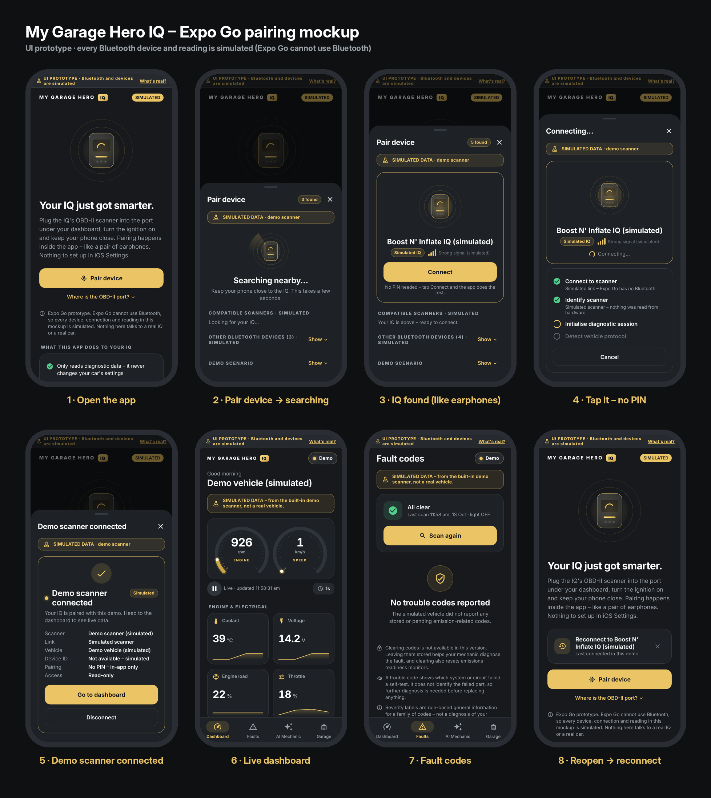

# My Garage Hero IQ – Expo Go pairing mockup

A tap-through **UI prototype** of the pairing experience: open the app → *Pair
device* → a list of nearby Bluetooth devices appears, like finding a pair of
earphones → tap the IQ → connected, no PIN → live dashboard and fault codes.

**Everything Bluetooth in here is simulated.** Expo Go cannot use Bluetooth
LE, so the device list, the connection and every reading are fake and are
labelled as such on every screen. This prototype must never be shown or
described as a working connection to a real IQ. The real app is the Flutter
project at the repository root.



## Show it on a phone (no Mac needed)

1. Install **Node.js LTS** on any computer (<https://nodejs.org>).
2. In a terminal:
   ```bash
   git clone https://github.com/Power-2-You/Obd-scanner.git
   cd Obd-scanner/mockups/expo-iq
   npm install
   npx expo start            # add --tunnel if the phone is not on the same Wi-Fi
   ```
3. On the phone, install **Expo Go**:
   * **iPhone:** App Store → *Expo Go* (the App Store build is SDK 54, which
     is what this project uses). Open the **Camera** app and scan the QR code
     shown in the terminal.
   * **Android:** Play Store → *Expo Go*. If it says the project needs an
     older Expo Go, install the **SDK 54** build from <https://expo.dev/go>.
     Open Expo Go and scan the QR code.
4. Press `w` in the terminal to open the same mockup in a browser.

## 90-second demo

1. *Pair device* → the sheet searches, the IQ appears as
   "Boost N' Inflate IQ (simulated)" with four signal bars; other devices
   (earbuds, speaker, TV) sit under *Show*.
2. Tap *Connect* → four steps run (connect, identify, initialise, detect
   protocol) → *Demo scanner connected*. No PIN at any point.
3. *Go to dashboard* → live RPM/speed gauges, coolant, voltage, load, throttle.
4. *Faults* tab → scan → "All clear" (or stored/pending codes with the
   *Check-engine light* scenario). There is no clear-codes button.
5. Tap the *Demo* pill → *Disconnect* → the welcome screen now offers
   *Reconnect to Boost N' Inflate IQ (simulated)*.

Scenario chips (*Healthy drive*, *Check-engine light*, *Ignition off*,
*Scanner busy*) live in the pair sheet under *Demo scenario* and in the
*What's real?* sheet. *Ignition off* ends in "vehicle not responding";
*Scanner busy* ends in a failed connection with troubleshooting tips.

## Real vs simulated

| Real | Simulated |
|---|---|
| Screens, copy, colours, flow, animations | Every Bluetooth device and signal strength |
| The product-owner rules (no PIN, no clearing codes, read-only) | The connection steps and their outcome |
| | Every reading, trouble code and timestamp |

For real hardware use the Flutter app (needs a Mac), or an Expo
**development build** with a BLE library – Expo Go can never do it.

## Layout

```
App.js                  state machine, home shell, sheets, web preview harness
src/theme.js            brand tokens (#EBC565 #F3F3F3 #FFFFFF #17191C + derived)
src/sim.js              simulated devices, steps, scenarios, vehicle values, codes
src/components.js       cards, pills, banners, buttons, nav bar pieces
src/IqHeroGraphic.js    animated IQ illustration with signal rings
src/gauges.js           arc gauges and metric tiles (react-native-svg)
src/preview.js          web-only ?screen=… harness used for screenshots
src/screens/            Welcome, PairSheet, AboutSheet, Dashboard, Faults
```

Expo SDK 54 · React Native 0.81 · plain JavaScript · no native modules beyond
what Expo Go ships. Screenshots: `docs/screenshots/expo-mockup/`.
